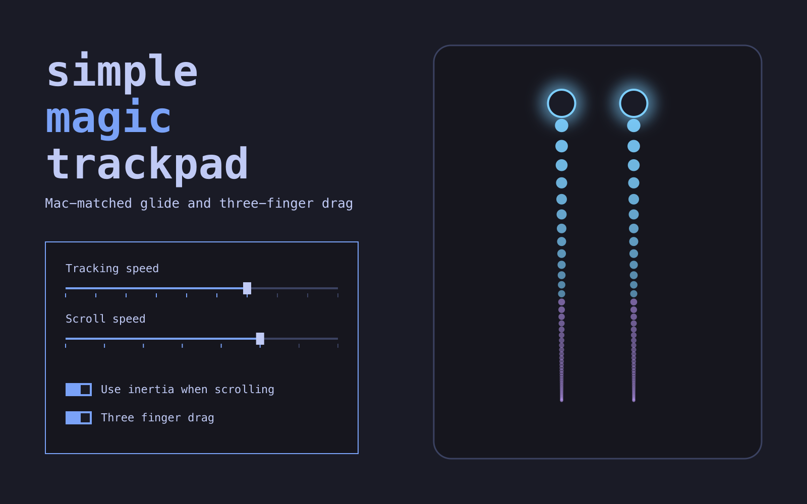

# Simple Magic Trackpad

Make the Apple Magic Trackpad 2 behave like it does on a Mac under Linux: three-finger
drag, a glide measured against a real Mac, and Mac pointer and scroll curves. Developed
on KDE Plasma 6.8 (KWin Wayland, libinput 1.32).

## Plan and status

| Step | What | Mechanism | Status |
|---|---|---|---|
| 1 | Check Electron/Zen | Electron 42+ already runs native Wayland and Chromium flings on its own; Zen swipe back/forward and pinch zoom already work (confirmed 2026-11-02) | done, nothing to change |
| 2 | Mac pointer + scroll curves | `accel/`: libinput custom profile via a shim preloaded into KWin | **built; first install never loaded (secure-exec), reinstall pending** |
| 3 | Fork linux-3-finger-drag into this repo | `daemon/`: same behaviour, own service | built, switch-over pending |
| 4 | Momentum scrolling everywhere | daemon keeps two synthetic fingers gliding after lift | **built, on trial** (daemon running unenabled; switch-over pending) |
| 5 | 4-finger pinch → launcher / show desktop | KWin declarative script | todo |
| 6 | 4-finger down → App Exposé, right-edge swipe → notifications | daemon | todo |

Decided against: smart zoom (two-finger double-tap). It would have to delay every
two-finger tap (right-click) by ~250 ms, and tap timing was out of scope.

Already Mac-like, left alone: 4-finger up = Overview (Mission Control); 4-finger
left/right = workspace or column scrolling, whichever your window manager uses.

## Step 2: Mac pointer and scroll curves (`accel/`)

**Why a shim.** macOS's pointer curve is very slow at low finger speeds (≈4 px/mm
at 5 mm/s) and very fast at high ones (≈64 px/mm at 250 mm/s); libinput's adaptive
profile at KWin speed 0.25 is a flat ≈17 px/mm across most of that range. libinput
has a *custom* profile that takes a sampled curve (separately for pointer motion and
for scrolling), but KWin 6.8 only offers flat/adaptive and never passes curve
points. Nothing outside the compositor can set it.

`mac-accel-shim.c` is preloaded into `kwin_wayland` only, through a systemd drop-in on
`plasma-kwin_wayland.service`. It wraps three libinput calls:

- `libinput_get_event`: on DEVICE_ADDED for a Magic Trackpad, apply the curve;
- `libinput_device_config_accel_set_profile`: when KWin sets "adaptive", apply the
  curve on top (so KWin's own saved-settings pass, and later setting changes, keep it);
- `libinput_device_config_accel_get_profile`: report "adaptive" while the curve is
  active, so System Settings shows a profile it knows.

Only devices with vendor 0x004c/0x05ac, product 0x0265 and gesture capability are
touched. If `~/.config/mac-trackpad/accel.conf` is missing or invalid, nothing changes.
**Why /usr/lib and the setuid bit.** `kwin_wayland` has the `cap_sys_nice` file
capability, so glibc runs it in secure-execution mode, where `LD_PRELOAD` entries
with a slash are silently dropped and a bare name is only loaded from the standard
library directories if the file is set-user-ID. The first install (2026-11-02) put
the shim in `~/.local/lib`, and KWin never loaded it. The setuid bit on a library
just satisfies that check; it is never executed. It does mean any setuid program
could be made to preload it, which runs nothing but the `kwin_wayland` name check.

The shim unsets `LD_PRELOAD` inside kwin_wayland so Xwayland and other children don't
inherit it (kwin_wayland_wrapper keeps it, so a restarted KWin gets it again).

**The curve.** `mac-params.json` holds the parametric curves read from the Mac
(`ioreg -r -c AppleMultitouchDevice -l`: `HIDAccelCurves`, `HIDScrollAccelCurves`),
plus the Mac's settings: tracking speed 1.5, scroll acceleration 0.3125 (default).
`mac_curves.py` evaluates them (formula and units per WebKit's BSD-licensed
re-implementation, see NOTICE) and writes 64 libinput points per curve: input
device units/ms at the trackpad's 47 units/mm, output px/ms at 96 dpi. Scroll output
is divided by KWin's scroll factor (1.4) so KWin's "Scrolling speed" slider stays a
working multiplier around the Mac default.

**Escape hatch without logging out:** System Settings → Touchpad → Acceleration
profile "Flat" bypasses the curve (the shim only acts on "adaptive").

### Install / tune / undo

```sh
cd accel && ./install.sh      # builds, installs, writes accel.conf; log out + in
mac-trackpad-accel status     # is KWin using it?
mac-trackpad-accel set --pointer-gain 1.2 --scroll-gain 0.8   # regenerate + apply live
mac-trackpad-accel reload     # re-apply after hand-editing accel.conf
./uninstall.sh                # then log out + in
```

Files it installs:

| Path | What |
|---|---|
| `/usr/lib/libmac-accel-shim.so` (root, mode 4755) | the shim (the one `sudo` step) |
| `~/.config/systemd/user/plasma-kwin_wayland.service.d/mac-trackpad-accel.conf` | `Environment=LD_PRELOAD=libmac-accel-shim.so` for KWin only |
| `~/.config/mac-trackpad/accel.conf` | curve points (regenerated by `set`) |
| `~/.local/bin/mac-trackpad-accel` | tuning helper |

Test without KWin: `make test-shim && LD_PRELOAD=./libmac-accel-shim.so ./test-shim
/dev/input/eventN` opens the touchpad with libinput the way KWin does and prints the
resulting profile (no input is read).

If KWin ever fails to start because of the shim: from a TTY, delete the drop-in file
above and run `systemctl --user daemon-reload`. If the .so is just missing, the
dynamic loader ignores the preload and KWin starts normally.

## Step 3: the daemon (`daemon/`)

A fork of [lmr97/linux-3-finger-drag](https://github.com/lmr97/linux-3-finger-drag)
2.0.0 (MIT; see NOTICE). The first commit (7394acf) is the verbatim upstream copy, so
`git diff 7394acf -- daemon/` shows everything this project changed. It does the same
thing as before: exclusively grabs the real trackpad, re-emits it through a uinput
clone with the same name/vendor/product (so KWin's saved per-device settings still
apply), and turns a 3-finger touch into a left-button drag on a separate virtual
pointer. Later steps add momentum and gestures here, since it is the only process
that sees raw touches.

Renamed so it can't be confused with the old install: binary `mac-trackpad`
(`~/.local/bin`), user unit `mac-trackpad.service`, config
`~/.config/mac-trackpad/daemon.json` (same keys as `3fd-config.json`, copied from it
on first install; hot-reloaded), clone `phys` marker `mac-trackpad/proxy`, drag pointer
"Virtual trackpad (created by mac-trackpad)".

Start-up is event-driven: enabled
for the graphical session (trackpad already connected at login) plus
`99-mac-trackpad.rules`, which starts the unit whenever any touchpad appears
(Bluetooth reconnect, resume). No polling or restart loops.

`cargo test` runs the gesture state machine suite (30 tests). The ignored integration
test creates a fake uinput touchpad and injects drags; don't run it in a live session,
KWin would act on the fake device's clicks.

### Momentum (step 4)

Qt apps (Konsole, Dolphin) and GPUI apps have no fling of their own, so a
flick stopped dead the moment the fingers lifted. The daemon now adds it for every
app, at the input level:

- A live 2-finger touch that loses its fingers while moving faster than 20 mm/s
  (least-squares slope over its last 80 ms) is a flick. The lift is withheld from the
  clone, and its two fingers keep moving on it in the release direction, slowing the
  way macOS does (see [docs/apple-momentum-research.md](docs/apple-momentum-research.md),
  from WebKit's `MomentumEventDispatcher`, Apple's own copy of the system curve). Every
  8 ms the *finger* speed is multiplied by 0.975 (τ 316 ms), blending linearly down to
  0.91 (τ 85 ms) below 15.9 mm/s, so slow flicks fade out quickly and smoothly. As on
  macOS, the scroll acceleration curve (libinput's Mac curve from accel.conf) applies to
  the glide like any finger motion. It ends once each axis is at or below 1.9 mm/s (or
  after a 3 s safety cap), then the fingers lift (slots and tool bits). A 300 mm/s flick
  glides ~93 mm of finger travel over ~1.2 s.
- Fingers never lift together: the others get 60 ms to follow the first. If one stays
  down, it wasn't a flick; the glide stops and that finger becomes a normal touch.
- Touch to stop: any touch freezes the glide. The glide fingers hold still for
  160 ms and only then lift, and the new touch is held back until they have. GTK,
  Firefox and Chromium start their own fling at scroll-stop from the last ~150 ms of
  motion (GTK: `SCROLL_CAPTURE_THRESHOLD_MS`); holding still past that means they see
  zero velocity, so touching really stops. Those apps get this glide instead of their
  own (they never see the scroll stop until it has slowed down).
- libinput ends an Apple touch whose size drops below 10 (quirk `AttrTouchSizeRange
  =20:10`), which happens in the frames before a lift, so libinput would end the scroll
  before the glide could continue it. During a 2-finger scroll, sizes sent to the clone
  are floored at 16 (keeps a live touch alive, never starts a hovering one).
- Glides may run past the pad's edges: libinput only logs out-of-range positions
  (rate-limited) and still uses them. Its thumb detection only re-checks when a new
  finger lands, so a glide past the bottom edge stays a scroll.

`daemon.json` (all hot-reload; defaults are the Mac values): `momentum` (on/off),
`momentumFastDecay` (0.975), `momentumTailDecay` (0.91), `momentumTailSpeed` (15.875 mm/s),
`momentumStopSpeed` (1.905 mm/s), one measured on a Mac: `momentumMinSpeed` (20 mm/s
at lift to start a glide), and one that isn't Apple's: `momentumStopHold` (160 ms).
`threeFingerDrag` (default false) turns the 3-finger drag on; while it is off those touches are relayed. Tests: `flick_glides_then_lifts_cleanly` and the other momentum
tests in `gesture/tests.rs`, plus `randomized_flick_invariants` (24,000 flick rounds
with touch-to-stop, taps, drags and resyncs, checking the clone never desyncs or keeps
a phantom touch).

**Wheel output (the default).** The glide fingers described above are "still down", so
Zen/Firefox keep a page stretched at its limit (overscroll) until the glide ends.
`"momentumOutput": "wheel"` relays the lift at once and runs the same glide as
high-resolution wheel events on a separate device, "Momentum wheel (created by
mac-trackpad)" (the drag pointer is left as it was). `"momentumOutput": "fingers"` is the
older synthetic-finger glide above.
libinput's scroll curve doesn't apply to wheel events, so finger travel is converted
linearly: `momentumWheelGain` (24 = one notch per 5 mm of finger glide, about the Mac
distance in KDE apps at ~60 px per notch; the real scale depends on each app).
**The direction assumes natural scrolling on the touchpad** (the Mac default) and not on
the new device. With natural scrolling off, the glide runs the wrong way: turn natural
scrolling on, or set `"momentumWheelInvert": true`. A touch
stops the glide at once (no hold). Known risk: with the lift visible, GTK, Firefox and
Chromium may start their own fling as well; the wheel events should cancel it, but
look for a kick or a doubled glide at the lift. Tests: the `wheel_*` tests and the
`*_wheel` fuzz runs.

### Installing the daemon

The udev rule needs your username, so the install fills it in. If another
three-finger-drag daemon is running, stop it first, since only one can grab the pad.

```sh
cd daemon && ./install.sh
sed "s/@USER@/$USER/" 99-mac-trackpad.rules | sudo tee /etc/udev/rules.d/99-mac-trackpad.rules >/dev/null
sudo udevadm control --reload-rules
systemctl --user enable --now mac-trackpad.service
```

To remove the service and rule:

```sh
systemctl --user disable --now mac-trackpad.service
sudo rm /etc/udev/rules.d/99-mac-trackpad.rules
sudo udevadm control --reload-rules
```

The daemon needs uinput access for the `input` group, for example through a rule in
`/etc/udev/rules.d/60-uinput.rules`.

## Settings app (`app/`)

"Apple Magic Trackpad", a small app (Python 3 + PyQt6 + Qt Quick Controls, no KDE libraries) with
only the trackpad options macOS has: Tracking speed (its 10 positions), Scroll speed (its 8), Use
inertia when scrolling and Three finger drag. Changes apply live: the switches set `momentum`
and `threeFingerDrag` in `daemon.json` (atomic write, other keys kept, 300 ms debounce;
the daemon hot-reloads it), the speeds run `mac-trackpad-accel set ...` (500 ms debounce). Everything else
stays out of the app on purpose: the glide's `momentum*` keys are edited in
`daemon.json`, the gains and resolution with `mac-trackpad-accel set`, and the app
carries them over unchanged.

What works where:

| | KDE Plasma | Hyprland | Other desktops |
|---|---|---|---|
| Use inertia when scrolling, Three finger drag | yes | yes | yes (they only edit `daemon.json`) |
| Tracking speed, Scroll speed | yes (needs `accel/install.sh`) | yes (needs `accel/install.sh`) | sliders disabled, with a note; stored values are still shown and `mac-trackpad-accel` is never run |
| Look | the desktop's Qt Quick style | Fusion (follows light/dark mode) | Fusion (follows light/dark mode) |

The speeds are applied through a KWin shim on KDE and through Hyprland's own
per-device config on Hyprland (see [Omarchy](#omarchy)), so they exist only there
(detected from `XDG_CURRENT_DESKTOP`, or `HYPRLAND_INSTANCE_SIGNATURE` for
Hyprland). Without `mac-trackpad-accel` the status bar says so.

Packages (Python 3 and PyQt6 with Qt Quick Controls 2):

- Arch: `python-pyqt6`, `qt6-declarative`
- Fedora: `python3-pyqt6`, `qt6-qtdeclarative`
- Debian/Ubuntu: `python3-pyqt6`, `python3-pyqt6.qtquick`, `qml6-module-qtquick-controls`,
  `qml6-module-qtquick-layouts`, `qml6-module-qtquick-window`, `qml6-module-qtqml-workerscript`
  (this list has not been tested)

```sh
app/mac-trackpad-settings            # run from the repo
app/install.sh                       # ~/.local/bin + ~/.local/share + launcher entry
                                     # + System Settings > Mouse & Touchpad entry (KDE only shows it)
app/uninstall.sh
python3 -m pytest app/tests          # or: python3 -m unittest discover -s app/tests
```

On KDE there's also a compiled version, a real page in System Settings > Mouse &
Touchpad with the same controls (`kcm/`). It needs `cmake` and `extra-cmake-modules`,
and installing it needs sudo. It takes over the app's System Settings entry; the app
stays in the launcher. Rebuild it after a major Plasma or Qt update.

```sh
kcm/install.sh
kcm/uninstall.sh
```

`MAC_TRACKPAD_CONFIG_DIR` (must end in `/mac-trackpad`) points it at another config
dir, `MAC_TRACKPAD_ACCEL` at another `mac-trackpad-accel`, `MAC_TRACKPAD_CURVES` at
another `mac_curves.py`, whose `mac-params.json` supplies the speeds' defaults
(default: the repo's, else `${XDG_DATA_HOME:-~/.local/share}/mac-trackpad/`, where
`accel/install.sh` copies both files).

## Omarchy

An [Omarchy](https://omarchy.org) Quattro shell plugin with the same four controls as the
app: a trackpad icon in the bar that opens a panel with Tracking speed (10 positions),
Scroll speed (8), Use inertia when scrolling and Three finger drag, drawn with the
shell's own theme. Plugin id `io.github.herunan.simple-magic-trackpad`; this repository is
the plugin (`manifest.json`, `omarchy/BarWidget.qml`, `omarchy/Panel.qml`,
`omarchy/Model.js`).

> [!WARNING]
> Not tested: the plugin has never been loaded in an Omarchy shell (it was written
> and linted without Quickshell, Hyprland or Omarchy installed); the Hyprland curves
> have only been run against a fake `hyprctl` (Lua and hyprlang), never a real
> Hyprland; the daemon has never run under Hyprland; the install steps below have not
> been run on Omarchy. What is said here about Hyprland and Omarchy comes from their
> source code. The KWin path is the one in use.

### Natural scrolling

Omarchy ships with touchpad `natural_scroll = false`, but the glide assumes it's on, like
a Mac. Set `natural_scroll = true` in `~/.config/hypr/input.lua` to scroll like a Mac, or
keep it off and add `"momentumWheelInvert": true` to `~/.config/mac-trackpad/daemon.json`.
Otherwise the glide runs opposite to your fingers.

### What it needs

The plugin is only the panel. The work is done by two pieces from this repository,
which `omarchy plugin add` does not install (it never runs anything from a plugin):

- **The daemon** (`daemon/`, inertia and three finger drag). Build dependencies: a Rust
  toolchain (`cargo`, from Arch's `rust` or `rustup` package) and a C linker (`base-devel`).
  At run time it needs the `uinput` module, the `input` group and two udev rules
  (`60-uinput.rules`: uinput access for the `input` group; `99-mac-trackpad.rules`:
  starts the user service whenever a touchpad appears). Without it the two switches
  change `daemon.json` and nothing reads it; the panel says so.
- **The curve tool** (`accel/`, tracking and scroll speed): `python3`. On Hyprland
  `accel/install.sh` installs no shim and needs no sudo (see below). Without it the
  speed sliders are disabled; the panel says so.

### Install

```sh
omarchy plugin add https://github.com/herunan/simple-magic-trackpad.git --enable

# The daemon and the curve tool, from a copy outside the plugin folder: the shell
# reloads a plugin whenever a file in its folder changes, and cargo writes thousands.
mkdir -p ~/.local/src
cp -r ~/.config/omarchy/plugins/io.github.herunan.simple-magic-trackpad ~/.local/src/simple-magic-trackpad
cd ~/.local/src/simple-magic-trackpad

# the daemon (once): permissions, build, service
sudo install -m644 daemon/60-uinput.rules /etc/udev/rules.d/
sudo gpasswd --add "$USER" input
echo uinput | sudo tee /etc/modules-load.d/uinput.conf
sudo modprobe uinput
# the rule names the user whose service it starts; put yours in
sed "s/@USER@/$USER/" daemon/99-mac-trackpad.rules \
  | sudo tee /etc/udev/rules.d/99-mac-trackpad.rules >/dev/null
sudo udevadm control --reload-rules
daemon/install.sh                      # cargo build, ~/.local/bin/mac-trackpad, user unit, daemon.json
# log out and in once (input group), then:
systemctl --user enable --now mac-trackpad.service

# the curves
accel/install.sh
```

On Hyprland `accel/install.sh` installs `~/.local/bin/mac-trackpad-accel` and
`~/.local/share/mac-trackpad/{mac_curves.py,mac_hyprland.py,mac-params.json}`, writes
`~/.config/mac-trackpad/accel.conf` if there is none, and runs `mac-trackpad-accel
reload`, which writes `~/.local/state/omarchy/toggles/hypr/mac-trackpad-accel.lua` (a
directory Omarchy loads on every Hyprland config reload) and applies it at once with
`hyprctl eval`. It never edits `hyprland.lua`, `hyprland.conf` or `input.lua`.

### What the plugin runs and touches

- Runs one command, `~/.local/bin/mac-trackpad-accel set --pointer-setting … --step …`,
  half a second after a speed slider stops moving. That runs `python3` and `hyprctl -j
  status`, `hyprctl -j devices` and `hyprctl eval`. No second Quickshell, no sudo.
- Reads `~/.config/mac-trackpad/daemon.json` and `accel.conf` (followed live), and
  `mac-params.json`; checks that `~/.local/bin/mac-trackpad-accel` and
  `~/.config/systemd/user/mac-trackpad.service` exist.
- Writes nothing when the shell starts or the panel opens. A switch, 300 ms after it is
  flipped, re-reads `daemon.json` and writes back only its own key (`momentum` or
  `threeFingerDrag`), atomically, every other key kept. A stored speed between two
  slider positions is shown at the nearest one and only rewritten if you move it.

### How the curves work on Hyprland

Hyprland hands a device's `accel_profile = custom <step> <points…>` and `scroll_points =
<step> <points…>` straight to libinput's custom profile, the thing the KWin shim exists
to reach, so `mac-trackpad-accel` picks Hyprland at run time (`HYPRLAND_INSTANCE_SIGNATURE`
set, or `XDG_CURRENT_DESKTOP` containing Hyprland) and lets `accel/mac_hyprland.py` write
it:

- Lua config (Hyprland 0.55+, the only kind since 0.57; Omarchy Quattro): `hl.device({
  name = …, accel_profile = "custom …", scroll_points = "…", scroll_factor = 1.0 })` in the
  Omarchy toggles file above, applied live with `hyprctl eval`. Without Omarchy it writes
  `~/.config/hypr/mac-trackpad.lua` and prints the `dofile(…)` line to add.
- hyprlang config (Hyprland 0.56 and older): `~/.config/hypr/mac-trackpad.conf` with
  `device { … }` blocks, applied live with `hyprctl keyword device[NAME]:…`; it prints
  the `source = …` line to add to `hyprland.conf` and never adds it itself.
- The scroll curve is generated for a Hyprland scroll factor of 1 (`--kwin-scroll-factor
  1`), and the trackpad gets `scroll_factor = 1.0`, replacing Omarchy's touchpad default
  of 0.4 for this device only. Omarchy's per-window `scroll_touchpad` rules (terminals)
  still win inside those windows.
- Device names come from `hyprctl devices`: every pointer with `magic-trackpad` in its
  name. The daemon's clone has the real pad's name, and Hyprland renames a second device
  of the same name with `-1` (`-2`, … while an old one is still there), in the order
  they appear. The clone is the one that moves the pointer while the daemon runs, so
  both names are configured, plus `-2` and `-3`, which a re-login or Bluetooth
  reconnect can hand out. Names go into Lua only as escaped string data.

`mac-trackpad-accel status` shows the config type, the file and the trackpads found.

### Omarchy's three-finger gestures and Three finger drag

Three finger drag is off by default, so Omarchy's three-finger swipes
(`default/hypr/gestures.lua`: left/right switch workspace, up opens the AI console, down
the Omarchy menu) keep working. If you turn it on, the daemon keeps every three-finger
touch from the compositor and turns it into a drag, so those gestures stop working. To
keep them too, move them to four fingers in `~/.config/hypr/input.lua` (unset the
three-finger ones first, or set `omarchy_default_gestures = false` in `hyprland.lua` and
add your own; Omarchy already uses four-finger left, right and down). Don't also turn on
Hyprland's own `drag_3fg`.

### Remove

```sh
cd ~/.local/src/simple-magic-trackpad
accel/uninstall.sh                     # tool, data and the toggles file; then:
hyprctl reload
systemctl --user disable --now mac-trackpad.service
rm ~/.local/bin/mac-trackpad ~/.config/systemd/user/mac-trackpad.service
sudo rm /etc/udev/rules.d/99-mac-trackpad.rules
sudo udevadm control --reload-rules
omarchy plugin remove io.github.herunan.simple-magic-trackpad
```

`~/.config/mac-trackpad/` (your settings) and the copy in `~/.local/src` are left;
delete them by hand if you want. `60-uinput.rules` and the `input` group may be used
by other tools and are left too.

## Findings worth keeping

- KWin's built-in touchpad gestures (v6.8.2): 3/4-finger left/right = switch desktop,
  4-finger up = Overview, 4-finger down = Grid View, 3-finger pinch = Zoom effect. None
  can be rebound or disabled except by disabling the owning effect; script gesture
  handlers fire *alongside* built-ins. KWin has no touchpad edge gestures.
- libinput: out-of-range MT coordinates are only logged; touches end when touch size
  falls below the 20:10 quirk; a still finger never sends axis_stop. GTK, Firefox and
  Chromium (Wayland) each start their own fling at axis_stop from the last 100–200 ms of
  motion; Qt adds none. Chromium under XWayland has no fling.
- `libinput list-devices` shows libinput defaults; KWin's applied values are on
  D-Bus: `busctl --user get-property org.kde.KWin /org/kde/KWin/InputDevice/eventN
  org.kde.KWin.InputDevice <prop>`.

## License

MIT, see [LICENSE](LICENSE). `daemon/` is based on linux-3-finger-drag by Martin Reid, also MIT
([daemon/LICENSE](daemon/LICENSE)). See [NOTICE](NOTICE) for other credits.
