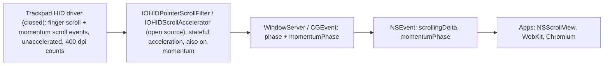

# How macOS makes trackpad scroll momentum

Research notes for matching the macOS 2-finger flick glide 1:1 in the daemon
(`daemon/src/runtime/gesture.rs`, `Momentum` / `glide_tick`).
Written 2026-11-04. Sources were read at WebKit `main` (last change to
`MomentumEventDispatcher.cpp`: 1468862807, 2026-10-29), IOHIDFamily tag
`IOHIDFamily-2238.100.59`, Chromium `main`, GTK `main`, and Qt `dev`.

How sure each point is:

- **[src]**: read directly in open-source code (file and line given).
- **[apple-replica]**: from WebKit code that Apple engineers wrote to copy
  the closed system curve. Their commit messages say it is "very close" to the
  system's (details below). This is the best public description there is.
- **[inferred]**: my own reasoning from the sources above.
- **[unknown]**: no public source found. Don't treat any number here as Apple's.

---

## 1. TL;DR

1. **The trackpad driver makes the momentum, not AppKit or apps.** The HID
   event driver sends extra scroll events with the momentum flags set
   (`kHIDDispatchOptionScrollMomentumStart/Continue/End`,
   IOHIDFamily `IOHIDEventService.h` L57-60) [src]. That driver
   (AppleMultitouch / MultitouchHID) is closed source. Apps only see
   `NSEvent.momentumPhase`, and so does Chromium [src].
2. **The decay runs on the unaccelerated delta, and the scroll acceleration
   curve is applied again to every momentum event.** IOHIDFamily's scroll
   filter runs events with the momentum flag through the same stateful
   `IOHIDScrollAccelerator` as finger events [src]. WebKit's replica decays the
   unaccelerated delta and then accelerates each frame with the device's
   `HIDScrollAccelCurves` [apple-replica]. **This is the opposite of the
   current module doc's claim that macOS decays the *output* speed.**
3. **The decay law** [apple-replica], per 8 ms of time:
   `d ← d · α(v)` with
   `α(v) = 0.975 − 0.065 · max(0, (250 − v)/250)`,
   where `v` = |unaccelerated delta| in counts/s.
   - Fast glide: τ = −8 ms/ln 0.975 = **316 ms**.
   - Below 250 counts/s it blends linearly down to 0.91: τ = **85 ms** at v→0.
   - The glide stops when every axis is at **≤ 0.5 counts per 60 Hz frame**.
   - There is no other cap, and the system gives no glide distance either.
4. In daemon units (Apple trackpads scroll at 400 counts/inch, so 1 count = 0.0635 mm):
   - tail speed 250 counts/s = **15.9 mm/s**
   - stop speed 0.5 counts/frame = 30 counts/s = **1.9 mm/s**
   - Because `GLIDE_FRAME` is already 8 ms, each tick is simply
     `v ← v·α(v)` with no exponent.
5. **The faster decay at low speed already gives what the friction term was
   added for.** Slow flicks fade smoothly to nothing (for example, 8 mm/s gives
   a 0.17 s glide), so no "none, then lots" jump. No hard minimum start speed is
   needed for that.

---

## 2. Where momentum lives in macOS



- **Momentum is dispatched at `ScrollMomentumDispatchRate`.** This is a
  per-HID-service property; WebKit falls back to 60 Hz
  (`ScrollingAccelerationCurveMac.mm` L157-160) [src].
  `IOHIDPointerScrollFilter.cpp` L575-610 multiplies a momentum event's value
  by `dispatchRate/60` before the accelerator and divides it out afterwards.
  The accelerator therefore always sees deltas as if they came at 60 Hz [src].
- **The acceleration history continues from the finger events.** The
  accelerator keeps a ring of the last **9** events
  (`SCROLL_EVENT_AVARAGE_LENGHT`). It only resets on a direction change or a
  gap over **500 ms** (`IOHIDAcceleration.cpp` L35-59, `.hpp` L21-23) [src].
  So the momentum starts from the same acceleration multiplier the content had
  at lift [src + inferred].
- **The scroll velocity estimate** (`IOHIDAcceleration.cpp` L81-109;
  constants in `.hpp` L24-27, fixed point /65536) [src]:
  `vel = (A·t̄² − B·t̄ + C) · mean|Δ|`, with A = 2/65536,
  B = 955/65536 (`0x3bb`), C = 98369/65536 (`0x18041`).
  - t̄ = mean event interval in ms, clamped to 1..150.
  - Each interval counts as at most 150 ms; the window stops at 500 ms.
  - The minimum velocity is 1/65536.
  - Then `mult = curve(vel)/vel`, and the output is `Δ·mult·0.1`
    (`SCROLL_PIXEL_TO_WHEEL_SCALE` = `0x199a`).
- **The end event says why momentum stopped.** It carries
  `kIOHIDEventScrollMomentumInterrupted` (the user touched the pad) or not
  (a natural end). The finger-phase Ended event carries
  `kIOHIDEventScrollMomentumWillBegin` (WebKit `WebEventFactory.mm` L278-286)
  [src]. So the system decides at lift whether a glide follows.

## 3. WebKit

### 3.1 `MomentumEventDispatcher`: Apple's replica of the system curve

File: `Source/WebKit/WebProcess/WebPage/MomentumEventDispatcher.cpp`.

**Why it exists.** It was added in 2021 to generate momentum at the display
refresh rate (for 120 Hz ProMotion) instead of using the system's 60 Hz
momentum events. Later commits tune it to match the system:

- `7e4025433e`, "MomentumEventDispatcher curve sometimes doesn't match the
  system curve", bug 233801.
- `e77769c0d2`, "Excessive kick at the beginning".
- `52d85940c6`, which says "In practice, our synthetic phase is very close
  in duration to the system one".
- A code FIXME (L226-228) describes how the system behaves internally: "The
  system falls back from the table to just generating deltas directly when the
  frame interval is within 20fps of idealCurveFrameRate".

So the authors could see system behaviour. These are not guesses.

**Algorithm (Default curve)** [apple-replica]:

| Step | Code | Detail |
|---|---|---|
| Seed history | L110-111, L380-416 | Finger-phase (Began/Changed) raw HID deltas and their intervals go into per-axis queues of size **9** (`.h` L150). A queue is cleared on a sign change or an interval > **500 ms** (L40). This is the same rule as IOHIDScrollAccelerator. |
| Initial delta | L229-230 | `d0 = rawPlatformDelta(momentum-Began event) × (dispatchRate/60) × momentumFastScrollMultiplier`. The value comes from the system and is per dispatch frame, rescaled to 60 Hz. |
| First event | L232-237 | The Began event's own delta goes through unchanged, and the curve is offset by it (`e77769c0d2`). |
| Per 60 Hz frame | L597-603, L576-590 | `d *= α(v)^(16.667/8)` with `v = |d|₂ / (1/60 s)` and `α` as in §1. Constants: `defaultDecay 0.975`, `tailVelocity 250`, `tailDecay 0.91`. |
| Accelerate | L605-647 | Push the decayed *unaccelerated* `d` into the same history. Compute `vel` with the IOHID formula (A, B, C as above, intervals clamped to 1..150 ms, window 500 ms, min 1/65536). Output `d · curve(vel)/vel`. |
| End | L454 | Loop `while |dx| > 0.5 or |dy| > 0.5`. |
| Tail | L437-449, L463-553 | Below 6 unaccelerated counts/frame, the output is rounded to whole pixels with carry. Frames are then re-spaced so the gaps between 1 px steps only grow. This only matters for whole-pixel rendering; Wayland scroll values are fractional, so skip it. |
| Interruption | L83-108 | Any non-momentum wheel event (for example fingers down) ends the glide. A natural system `Ended` is ignored, so WebKit's curve can outlast the system's (`52d85940c6`). |
| Output units | L151-175 | The output is multiplied by AppKit's own multiplier (`delta / unacceleratedDelta` of the starting event) to get points. |

**The acceleration curve.** `ScrollingAccelerationCurve::accelerationFactor`
(`Source/WebKit/Shared/ScrollingAccelerationCurve.cpp` L92-112) [src]:

- Speed is divided by `resolution/67`. The polynomial is
  `(q·x)^4 + (c·x)^3 + (p·x)^2 + l·x` up to `tangentSpeedLinear`, then the
  tangent line, then a `sqrt` falloff from `tangentSpeedParabolicRoot` on.
- The result is multiplied by `96/67`.
- Parameters are read from the HID service: `HIDScrollAccelCurves`,
  `HIDScrollResolution`, the acceleration setting, and
  `ScrollMomentumDispatchRate` (`ScrollingAccelerationCurveMac.mm` L107-163).
- WebKit's fallback curve (`ScrollingAccelerationCurve.h` L110-122) is
  `l 0.925, p 0.75, c 0, q 0, tangentLinear 6.3, tangentRoot 12, res 400, 60 Hz`.
  That is exactly the 50/50 blend of the 0.125 and 0.5 rows of our
  `accel/mac-params.json` scroll table, i.e. the **default scroll setting
  0.3125** [src + verified here].
  `accel/mac_curves.py` already implements this curve.

**Simple curve** (L661-669):

- `d *= exp(ln(0.998) · 16.67)` per frame. This is UIScrollView's
  `decelerationRate.normal` (0.998/ms, τ ≈ 500 ms), with **no** acceleration.
- It is used only for `inputSource == Automation` (L216). That includes the
  new AppKit-gesture path (§3.3). **It is not** the trackpad curve.

### 3.2 `ScrollingMomentumCalculator` (WebCore): only for scroll snapping

- `ScrollingMomentumCalculatorMac.mm` wraps AppKit's private
  `_NSScrollingMomentumCalculator`, created with
  `initWithInitialOrigin:velocity:documentFrame:…tolerance:{1,1}` (L105-116)
  [src].
  - It returns `positionAfterDuration:`, `durationUntilStop` and
    `destinationOrigin`.
  - It is used for **scroll-snap** animations, so it can predict where a glide
    lands and retarget it.
  - Its internal curve is **[unknown]** (private AppKit).
- `BasicScrollingMomentumCalculator` (non-Mac) has no physics
  (`ScrollingMomentumCalculator.cpp` L181-239) [src]:
  - The landing point is predicted as **16.7 × the initial wheel delta**.
    The comment says this was measured on macOS ≤10.10 (L38-46).
  - It then animates a 1 s exponential `s(t) = A − A·b^(−60t)` fitted to the
    starting speed (initial progress clamped to 0.1..0.5, at most 10
    iterations).
  - **Cross-check:** for the §3.1 model, my simulation (§6) gives total
    output ÷ first momentum delta = 12-18, which brackets 16.7.

### 3.3 WebKit's AppKit-gesture path: WebKit's own choices, not the system's

`UIProcess/mac/AppKitGestures/WKAppKitGestureController.mm` L2379-2478 [src].
This newer path scrolls with an `NSPanGestureRecognizer` instead of system
momentum events:

- A glide starts only if the larger axis of the pan velocity is
  **≥ 250 pt/s** (L2410).
- The initial delta is `velocity / momentumFrameRate` (L2459).
- It uses the **Simple** curve (0.998/ms).

**Consecutive-flick boost**, `WKFastScrollTracker.swift` L28-166:

- A flick only builds the chain if it began while a glide was still running
  and came within **1 s** of the last one.
- The chain breaks on a direction change or if the drag speed is
  < **130 pt/s**. It also resets if a flick ends slower than **600 pt/s**.
- The boost starts from the 4th chained flick:
  `mult += min(dist/240, 0.9) · (1 + 0.5·(n−3))`, capped at **16**.
- The multiplier is passed down as `momentumFastScrollMultiplier`.

The commit title, "Scrolling should accelerate on multiple quick swipes", hints
that the system does something similar. **The system's own boost rule is
[unknown].**

## 4. Chromium

- **macOS:** no fling curve. `components/input/web_input_event_builders_mac.mm`
  L210-212 and L618 copy `NSEvent.momentumPhase` into
  `WebMouseWheelEvent.momentum_phase`. The OS deltas are used as they are
  [src].
- **Other platforms** (touchpad `GestureFlingStart`): `ui/events/gestures/fling_curve.cc`
  L14-16 [src]:
  - Position: `x(t) = α·e^(−γt) − β·t − α`, with
    α = −5707.62, β = 172, γ = 3.7.
  - Velocity: `v(t) = 21118·e^(−3.7t) − 172` px/s. That is exponential decay
    (τ = 270 ms) plus constant friction (172 px/s): **the same family as the
    daemon's current `du/dt = −(u+c)/τ`**.
  - Starting speed is capped at v(0) ≈ 20946 px/s. Speed reaches 0 after at
    most ln(21118/172)/3.7 = **1.30 s**.
  - It is not tuned to macOS.
- **`PhysicsBasedFlingCurve`** (behind `kExperimentalFlingAnimation`,
  L15-21):
  - A cubic Bézier with control points (0.2, 1.0) and (0.55, 1.0).
  - Deceleration 2.7559e-5 in/ms² (≈ 700 mm/s²), max 2 s.
  - The distance is capped at the viewport × multiplier.
- **Fling boost** (`ui/events/blink/fling_booster.cc` L15-25):
  - It boosts only above 350 px/s, and needs a scroll speed of at least
    150 px/s.
  - The timeout is 50 ms.
- **`fling_controller.cc`** L34 ignores deltas ≤ 0.1. Progress runs at 60 Hz
  (L19).

## 5. Other Apple and third-party data points

- **UIScrollView** (iOS): `decelerationRate` `.normal` = 0.998 per ms
  (τ ≈ 500 ms), `.fast` = 0.99 (τ ≈ 100 ms). Pure exponential [Apple docs;
  WebKit L663 uses ln 0.998].
  - Apple's WWDC18 "Designing Fluid Interfaces" gives the iOS landing distance
    as `v/1000 · r/(1−r)`.
  - This is **not** the Mac trackpad curve. The Mac curve decays faster at
    first (316 ms vs 500 ms) and much faster in the tail.
- **NSScrollView** does not compute trackpad momentum. It applies the
  system's momentum events (and uses `_NSScrollingMomentumCalculator` for snap
  and prediction) [inferred from §2-3].
- **Mos** (`Caldis/Mos`, `ScrollCore/Interpolator.swift`, `ScrollPoster.swift`)
  smooths *mouse* wheels with lerp/smoothstep and its own thresholds
  (0.18 s / 0.45 s / 0.13 s). These are not Apple-derived.
  SmoothScroll, LinearMouse and Scroll Reverser change or reverse the system's
  events. None of them published measured Mac momentum curves that I could find.
  Web searches turned up only generic or made-up answers, so I give no numbers
  from them.

## 6. Glide start, release velocity, stop, cap, touch-to-stop

| Question | Answer | Confidence |
|---|---|---|
| Who decides a glide starts | The trackpad driver, at lift. It marks the phase-Ended event with `MomentumWillBegin`. | [src] |
| Minimum start speed | No threshold in the replica; any `d0` runs until ≤ 0.5 counts/frame. The system's own minimum is not public. (WebKit's AppKit path uses 250 pt/s, but that is WebKit's choice.) | [unknown] |
| Release velocity estimate | The system's method is not public; the momentum-Began delta just carries it. WebKit's "kick" fix shows the first momentum delta should continue the last finger frame smoothly. | [unknown] / [apple-replica] |
| Does momentum start from the accelerated content velocity at lift? | Yes. The unaccelerated `d0` is accelerated using a history that still holds the finger events, so the gain carries straight over. | [src + apple-replica] |
| Decay | `α(v)` per 8 ms, as in §1 | [apple-replica] |
| Stop threshold | Each axis ≤ 0.5 unaccelerated counts per 60 Hz frame (1.9 mm/s) | [apple-replica] |
| Max duration | No cap. In practice it is ≈ 0.316·ln(v0/15.9 mm/s) + ~0.28 s, so ≈ 1.4 s at 500 mm/s. | [inferred from replica] |
| Touch-to-stop | Fingers down: the system ends momentum with `Interrupted` (WebKit: "e.g. by tapping the trackpad"). The exact contact rule is not public. | [src] / [unknown] |
| Higher refresh rates | The curve is defined at 60 Hz and resampled. The accelerator rescales momentum deltas to 60 Hz. | [src] |

**Simulation.** Default curve, fallback acceleration curve, history seeded
with steady finger motion. Script:
`~/.gemini/antigravity-cli/brain/532a5bb9-…/scratch/sim_webkit_momentum.py`.

| d0 (counts/frame) | Finger speed (mm/s) | Glide (s) | Unaccelerated distance | Accelerated distance | Accelerated distance ÷ first frame |
|---|---|---|---|---|---|
| 2 | 8 | 0.17 | 10 | 3 | 5 |
| 8 | 30 | 0.52 | 107 | 41 | 12 |
| 32 | 122 | 0.95 | 550 | 434 | 13 |
| 64 | 244 | 1.17 | 1140 | 1302 | 14 |
| 128 | 488 | 1.38 | 2322 | 2973 | 18 |

## 7. Linux prior art, for contrast

| Stack | Model | Constants | Source |
|---|---|---|---|
| libinput | None. It sends a scroll-stop (axis 0) and leaves kinetic scrolling to callers, because driver-side kinetic scrolling sends events to the wrong window and mixes badly with modifier keys. | – | libinput docs, "Scrolling" |
| GTK 4 | Release velocity = sum(Δ)/(t_last − t_first) over the last **150 ms**. Then `v = v0·e^(−4t)` (τ = **250 ms**), stopping at \|v\| < 0.1. Touchpad velocity ×2.5. Flicks during a glide add speed: ×(floor 0.33, ceiling 1.0, max 6). | `DECELERATION_FRICTION 4`, `MAGIC_SCROLL_FACTOR 2.5` | `gtkeventcontrollerscroll.c` L66, L121-190; `gtkkineticscrolling.c` L181-206; `gtkscrolledwindow.c` L182-201, L3414-3431 |
| Qt `QScroller` (opt-in, touch/mouse drag) | OutQuad easing | `decelerationFactor 0.125`, min/max velocity 0.05/0.5 m/s, accelerating flick ×3 within 1.25 s | `qscrollerproperties.cpp` defaults() |
| Chromium on Linux/ChromeOS | `FlingCurve` (§4) | τ 270 ms, friction 172 px/s | `fling_curve.cc` |

None of these copy macOS. GTK and Chromium decay the *output* speed; macOS
decays the *input* speed and accelerates it again. A glide synthesised by the
daemon reaches clients as finger scrolling. GTK, Firefox and Chromium then run
their own kinetic scroll from the speed at the final lift, so a glide must end
near the stop speed. The Apple model does end there (1.9 mm/s).

---

## 8. Recommendation

### 8.1 Model to implement ("mac" glide)

Work in **finger (unaccelerated) space** and let libinput's Mac scroll curve
(`scroll_*` in accel.conf) do the job of IOHIDScrollAccelerator, as macOS
does. Each 8 ms `GLIDE_FRAME`:

```
v      = |finger velocity| (mm/s), along the release direction
alpha  = 0.975 - 0.065 * max(0, (V_TAIL - v) / V_TAIL)   // V_TAIL = 15.875 mm/s
v     *= alpha                                            // exact for 8 ms ticks; else alpha^(dt/8ms)
move fingers by v * dt (per axis, keep the release direction)
stop when |vx| <= 1.905 mm/s and |vy| <= 1.905 mm/s   (0.5 counts / (1/60 s) at 400 dpi)
```

This replaces `du/dt = −(u+c)/τ` in output space. The friction term and the
inverse curve (`curve⁻¹`) are then no longer needed. Keep the old model behind a
switch for A/B testing.

What is verified, and what is not:

- **Verified [src]:** the acceleration still applies during momentum, and its
  history continues from the finger phase.
- **[apple-replica]:** 0.975, 0.91, 250 counts/s and 0.5 counts/frame.
- **[inferred]:**
  - That 1 HID scroll count = 1/400 in of finger travel
    (`HIDScrollResolution` = 400 in `mac-params.json`). Apple's driver might
    scale finger travel before reporting it.
  - That libinput's custom-profile speed estimate behaves enough like
    IOHIDScrollAccelerator's (9-event mean with the quadratic interval term)
    for the output to match.
  - The interval term means Apple's gain is not fully report-rate
    independent. An exact match of the *output* would need that accelerator
    copied, and the daemon can't do that while libinput applies the curve.
- **Why the old finger-space attempt dropped off a cliff** [inferred]:
  - It used a single exponential. Apple's τ is 316 ms at speed, with the fast
    tail only below 15.9 mm/s.
  - Apple's acceleration gain is smoothed over ~9 events (≈150 ms at 60 Hz),
    which delays the gain drop.
  - Re-test with the Apple law before deciding that output-space decay is
    needed.

### 8.2 Other behaviour

- **Release velocity:** keep the 60 ms least-squares fit [unknown on Mac].
  The requirement is that the first glide frame continues the last finger frame
  without a jump.
- **Start threshold:** the Mac value is [unknown]. The faithful default is to
  glide whenever v0 > stop speed (1.9 mm/s); the curve makes small glides tiny.
  `DEFAULT_MIN_SPEED = 80 mm/s` is a project choice (for tap/gesture interplay),
  not Apple's. If it stays, document it as such.
- **Max duration:** Apple has no cap. Keep `GLIDE_MAX` 3 s as a safety net
  only; real glides end before 2 s.
- **Touch-to-stop:** Mac stops immediately on contact. `DEFAULT_STOP_HOLD`
  160 ms is a project choice.
- **Flick boost:** optional. Use WebKit's AppKit-gesture constants (§3.3) if
  wanted, labelled "WebKit emulation".

### 8.3 Knobs for a tuning app (Mac defaults)

| Knob | Mac default | Source |
|---|---|---|
| Momentum on/off | on | – |
| Glide decay (fast part), per 8 ms | 0.975 (τ 316 ms) | [apple-replica] |
| Tail decay, per 8 ms | 0.91 (τ 85 ms) | [apple-replica] |
| Tail speed (where the blend starts) | 250 counts/s = 15.9 mm/s | [apple-replica] |
| Stop speed | 0.5 counts/60 Hz frame = 1.9 mm/s | [apple-replica] |
| Minimum start speed | none (= stop speed) | [unknown]; current 80 mm/s is a project choice |
| Scroll acceleration setting (affects the glide too) | 0.3125 | `mac-params.json` / WebKit fallback curve [src] |
| Flick boost | off (system rule unknown) | WebKit AppKit gestures [src] |
| Safety cap | 3 s (not Mac) | project |

A simple "glide length" slider could scale τ_fast (316 ms) and leave the tail
alone, but that slider is a project addition with no Apple counterpart.

### 8.4 How to verify on a real Mac (not done here)

1. Log `NSEvent` scroll events in a test app: `scrollingDeltaY`,
   `_unacceleratedScrollingDeltaY` (private), `momentumPhase`, `timestamp`.
   Alternatively read `CGEventCopyIOHIDEvent` → `kIOHIDEventFieldScrollY`, as
   WebKit's `WebEventFactory.mm` does.
2. Check the per-frame ratio of the **unaccelerated** deltas: about 0.9486 per
   60 Hz frame while above ~4 counts/frame, then falling. Also check the last
   delta (~0.5) and the momentum event rate (`ScrollMomentumDispatchRate`).
3. Read `ioreg -r -c AppleMultitouchDevice -l | grep -i ScrollMomentum` for the
   dispatch rate.
4. Compare the first momentum delta with the last finger-phase deltas to learn
   the release-velocity estimator.

---

## 9. Sources

- WebKit:
  - `Source/WebKit/WebProcess/WebPage/MomentumEventDispatcher.cpp`
    L40-43, 57-149, 207-238, 336-461, 576-669; `.h` L146-181.
    https://github.com/WebKit/WebKit/blob/main/Source/WebKit/WebProcess/WebPage/MomentumEventDispatcher.cpp
  - `Source/WebKit/Shared/ScrollingAccelerationCurve.cpp` L92-112, `.h` L110-122,
    `Shared/mac/ScrollingAccelerationCurveMac.mm` L58-163
  - `Source/WebKit/Shared/mac/WebEventFactory.mm` L263-296
  - `Source/WebCore/platform/ScrollingMomentumCalculator.cpp` L37-46, 181-239;
    `platform/mac/ScrollingMomentumCalculatorMac.mm` L54-116
  - `Source/WebKit/UIProcess/mac/AppKitGestures/WKAppKitGestureController.mm`
    L126-132, 2379-2478; `WKFastScrollTracker.swift` L28-166
  - Commits: d34acc1627 (bug 233653, added), 7e4025433e (bug 233801),
    e77769c0d2 (bug 234279), 52d85940c6 (bug 234535), f4da5af098 (Simple
    curve), 59e1c6227c (fallback curve), ccb01872b9 (fast scroll)
- IOHIDFamily (`apple-oss-distributions/IOHIDFamily`, tag 2238.100.59):
  - `IOHIDEventSystemPlugIns/IOHIDAcceleration.cpp` L35-118, `.hpp` L21-31
  - `IOHIDEventSystemPlugIns/IOHIDPointerScrollFilter.cpp` L567-627, `.h` L26
  - `IOHIDFamily/IOHIDEventService.h` L53-70
- Chromium:
  - `ui/events/gestures/fling_curve.cc`, `physics_based_fling_curve.cc`
  - `ui/events/gestures/blink/web_gesture_curve_impl.cc`
  - `ui/events/blink/fling_booster.cc`
  - `components/input/fling_controller.cc`, `web_input_event_builders_mac.mm`
- GTK: `gtk/gtkkineticscrolling.c`, `gtkscrolledwindow.c`,
  `gtkeventcontrollerscroll.c` (gitlab.gnome.org/GNOME/gtk, main)
- Qt: `qtbase/src/widgets/util/qscrollerproperties.cpp`
- Apple: UIScrollView.DecelerationRate docs; WWDC18 session 803 "Designing
  Fluid Interfaces"
- libinput: https://wayland.freedesktop.org/libinput/doc/latest/scrolling.html

---

## 10. Measured on a real Mac (2026-11-04)

Magic Trackpad (Bluetooth) on an Apple Silicon Mac, macOS 26, tracking speed
1.5, scrolling speed **0.4412** (`com.apple.trackpad.scrolling`, raised from the
0.3125 default). 42 two-finger scrolls, 32 with a glide, recorded with
`tools/mac-recorder` (raw HID scroll counts per NSEvent via
`CGEventCopyIOHIDEvent`, as WebKit does). Data:
`docs/measurements/2026-11-04-magic-trackpad-macos26-scroll.csv`.

- **Momentum events come at 60 Hz** (16.7 ms), as integer raw counts.
- **Decay at speed: 0.9487 per 60 Hz frame**, measured over 89 frame pairs with
  deltas of 40-250 counts. The §3.1 model predicts 0.975^(16.67/8) = 0.9486.
- **Total glide distance** (raw counts) of every glide that ended on its own is
  within ~1-3% of the §3.1 model started from the measured first momentum delta
  (e.g. 2540 vs 2547, 3809 vs 3812, 304 vs 309).
- **The tail is slightly steeper than modelled** below ~6 counts/frame (measured
  0.93 / 0.89 / 0.84 per frame at 4-6 / 3-4 / 2-3 counts, model 0.949 / 0.928 / 0.897).
  Real glides end 2-3 frames (~50 ms) earlier, covering only a few counts. Part of
  this is integer rounding of the reported deltas. Not worth modelling.
- **A natural end** reports a last delta of 1 count, then 0.
- **The first momentum delta** is about the mean of the last 2-3 finger-phase
  deltas times one decay step (e.g. 185 → 176, 47 → 52, 228 → 198). The daemon's
  40 ms least-squares release velocity is the same idea.
- **Start threshold:** every lift while moving glided, down to the slowest flick
  recorded (first momentum delta 16 counts/frame = 960 counts/s ≈ 61 mm/s at
  400 cpi). Every non-glide had the fingers stopped for ≥ 0.4 s before the lift.
  A lift ~33 ms after the last motion event still glided. The threshold between
  0 and ~60 mm/s is not measured yet.
- **Not measured:** the Magic Trackpad's counts per mm of finger travel (the
  recorder's touch log missed it; the built-in pad reports HIDScrollResolution
  400). Neither was the point-delta gain, which depends on the 0.4412 setting.

## 11. Slow flicks and the start threshold, measured (2026-11-05)

Same Mac and Magic Trackpad, 50 two-finger scrolls (37 glides) focused on slow
lifts, this time with finger positions. Data:
`docs/measurements/2026-11-05-magic-trackpad-slow-flicks-{scroll,touch}.csv`.

- **Counts per mm: 15.66** (median of 7 long slides, range 15.14-16.36), so the
  Magic Trackpad's 400 cpi (15.75 counts/mm) assumption holds.
- **Release velocity window: 80 ms.** Least-squares finger speed over the last
  80 ms predicts the Mac's first momentum delta with a median ratio of 1.03
  (1.02 for slow flicks). The 40 ms window the daemon first used overshot by 20%
  (39% for slow flicks), which made slow glides too long. The mean of the last 5
  scroll deltas (~83 ms) fits about as well.
- **Glide distance, model from the lift speed vs the Mac** (median ratio):

  | Lift speed | 40 ms window | 80 ms window |
  |---|---|---|
  | under 40 mm/s | 1.37 | 0.98 |
  | 40-70 mm/s | 1.99 | 1.36 |
  | 70-110 mm/s | 1.17 | 1.04 |
  | over 110 mm/s | 1.06 | 1.07 |

  The bands use each window's own speed, so a flick can fall in different bands.
  The remaining 40-70 mm/s error comes mostly from very short flicks (a few mm of
  travel) whose Mac glide lasts only ~0.35 s. Their cause isn't known.
- **Start threshold: about 20 mm/s** over the 80 ms window. It isn't a clean line:
  glides and non-glides overlap between 17 and 24 mm/s, so macOS probably doesn't
  use finger speed alone. 20 mm/s misclassifies 4 of the 50 lifts (3 missed glides,
  1 extra). The earlier "0-60 mm/s" bound in section 10 is replaced by this.
- **Stopping before the lift:** the daemon also requires the last 40 ms to be above
  the threshold, so a scroll that stops just before the lift doesn't glide on its
  older motion. No measured Mac glide fails this check. The Mac's exact limit
  between a ~33 ms pause (glides) and a ~400 ms pause (doesn't) isn't measured.

## 12. The macOS slider values (2026-11-05)

Read from `defaults` while moving each slider notch by notch, macOS 26.6.2:

- **Tracking speed** (`com.apple.trackpad.scaling`): 0, 0.125, 0.5, 0.6875, 0.875,
  1, 1.5, 2, 2.5, 3.
- **Scroll speed** (`com.apple.trackpad.scrolling`): 0, 0.0735, 0.1265, 0.1838,
  0.3125, 0.4412, 0.5882, 1.
